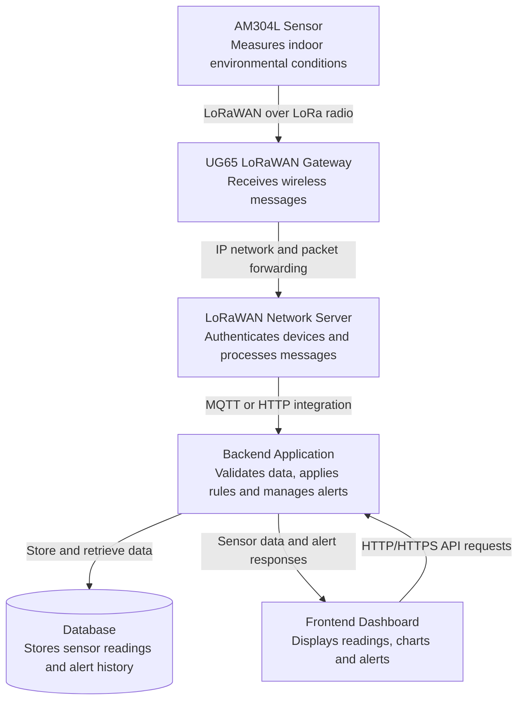

# IoT System Architecture and Data Flow

## 1. Overview

The purpose of this document is to describe the IoT system architecture using the Milesight AM304L Indoor Air Quality Sensor and the Milesight UG65 LoRaWAN Gateway.

The system collects indoor environmental data, transmits it to a network server, processes and stores the data, and presents the results through a dashboard.

The architecture consists of the following components:

- Indoor air quality sensor
- LoRaWAN gateway
- LoRaWAN network server
- Backend application
- Database
- Frontend dashboard

## 2. Updated IoT System Architecture

**Note:** This is a proposed logical architecture. The actual protocols and deployment depend on the existing LIA system configuration. The network server may be external or integrated into the gateway.

## 3. Component Functions

### 3.1 AM304L Indoor Air Quality Sensor

**Purpose:** Measure indoor environmental conditions.

Main responsibilities:

- Measure the environmental parameters supported by the sensor model.
- Prepare measurements for wireless transmission.
- Transmit sensor messages using LoRaWAN.
- Operate using the configured reporting interval and regional frequency band.

**Output:** Sensor measurements and device information.

### 3.2 UG65 LoRaWAN Gateway

**Purpose:** Connect LoRaWAN sensors to the IP network.

Main responsibilities:

- Receive LoRaWAN radio messages from compatible sensors.
- Forward messages to the configured network server.
- Provide network connectivity through the configured interface.
- Support communication with multiple compatible LoRaWAN devices.

**Input:** Wireless messages from sensors.

**Output:** Forwarded messages to the network server.

### 3.3 LoRaWAN Network Server

**Purpose:** Manage LoRaWAN network communication.

Main responsibilities:

- Manage device activation and network sessions.
- Validate and process received LoRaWAN messages.
- Handle network-level message processing and downlink scheduling.
- Forward sensor data to the configured application integration.

**Input:** Messages forwarded by the gateway.

**Output:** Sensor payloads and device metadata for the application.

### 3.4 Backend Application

**Purpose:** Process and manage sensor data.

Main responsibilities:

- Receive data from the network server.
- Decode the application payload if necessary.
- Validate readings and timestamps.
- Apply configured threshold rules.
- Generate alerts when defined conditions are met.
- Store readings and alert information in the database.
- Provide data to the frontend through an API.

**Input:** Sensor data from the network server.

**Output:** Validated readings, stored records and alert information.

### 3.5 Database

**Purpose:** Store sensor data for historical analysis.

Possible information to store:

- Device ID
- Room or sensor location
- Measurement type
- Measurement value and unit
- Timestamp
- Device status
- Alert status and alert history

**Possible technologies:** PostgreSQL or InfluxDB, depending on the project requirements.

### 3.6 Frontend Dashboard

**Purpose:** Present sensor information to users.

Main responsibilities:

- Display current environmental readings.
- Show historical measurements in charts.
- Display sensor and connection status.
- Highlight readings that exceed configured thresholds.
- Present alert history and relevant information for staff.

**Possible technologies:** HTML, CSS, JavaScript or React.

## 4. Communication Protocols

| Communication path | Protocol or technology | Purpose |
|---|---|---|
| Sensor → Gateway | LoRaWAN over LoRa radio | Wireless sensor communication |
| Gateway → Network server | IP networking; Semtech UDP Packet Forwarder or LoRa Basics Station, as configured | Forward LoRaWAN traffic |
| Network server → Backend | MQTT or HTTP integration, depending on configuration | Deliver sensor data |
| Backend → Database | Database driver and query protocol | Store and retrieve records |
| Frontend → Backend | HTTP/HTTPS REST API | Request readings and alert information |
| Backend → Frontend | HTTP/HTTPS responses; WebSocket if required | Deliver data for display and updates |

Not every protocol listed above is required. The actual implementation must be verified against the existing platform and configuration.

## 5. Data Flow

The data flow follows these steps:

1. **Measurement:** The AM304L measures indoor environmental parameters.
2. **Wireless transmission:** The sensor sends its data using LoRaWAN.
3. **Reception:** The UG65 gateway receives the radio message.
4. **Network processing:** The LoRaWAN network server processes the message.
5. **Application processing:** The backend receives, decodes and validates the data.
6. **Storage:** The backend saves the measurement and timestamp in the database.
7. **Analysis:** The backend or analytics service evaluates readings against configured thresholds.
8. **Presentation:** The frontend retrieves data through the API and displays readings, charts and alerts.

## 6. Data Analysis

The system can support the following analysis:

- Compare temperature and humidity measurements over time.
- Monitor the air-quality parameters available on the selected sensor model.
- Identify unusual readings or repeated threshold violations.
- Review historical trends for individual rooms.
- Identify missing measurements or devices that have stopped reporting.
- Display configured alerts for staff review.

Thresholds should be selected according to project requirements and appropriate indoor-environment guidance. Sensor readings should not be treated as a medical diagnosis.

## 7. Presentation and Dashboard Requirements

The dashboard should provide:

- Current readings and measurement units.
- Sensor name, device ID and room location.
- Historical charts with selectable time ranges.
- Device communication status and last-received timestamp.
- Clear indicators for configured threshold violations.
- An alert history with timestamps and status.

The presentation should make the information easy to understand and help staff identify conditions that may require further investigation.

## 8. Reliability and Security Considerations

- Use appropriate network credentials and secure configuration.
- Use HTTPS and secure MQTT connections where supported and configured.
- Validate incoming payloads before storing measurements.
- Record timestamps consistently.
- Monitor missing messages and gateway connectivity.
- Restrict access to the dashboard and stored data according to user roles.
- Follow applicable privacy and data-protection requirements.

## 9. References

- Milesight AM300 Series: https://www.milesight.com/iot/product/lorawan-sensor/am300
- Milesight UG65 Gateway: https://www.milesight.com/iot/product/lorawan-gateway/ug65
- Milesight Document Center: https://www.milesight.com/iot/resources/download-center/

The official datasheets and user guides should be consulted to verify the exact sensor capabilities, regional radio settings and gateway configuration.

## 10. Conclusion

The proposed architecture separates the wireless IoT infrastructure from the application software. The AM304L collects environmental data, the UG65 gateway forwards LoRaWAN messages, and the network server processes the LoRaWAN communication. The backend validates and analyses the measurements, the database stores historical information, and the frontend presents readings and alerts through a dashboard.

This separation supports maintainability, troubleshooting, historical analysis and future system expansion.